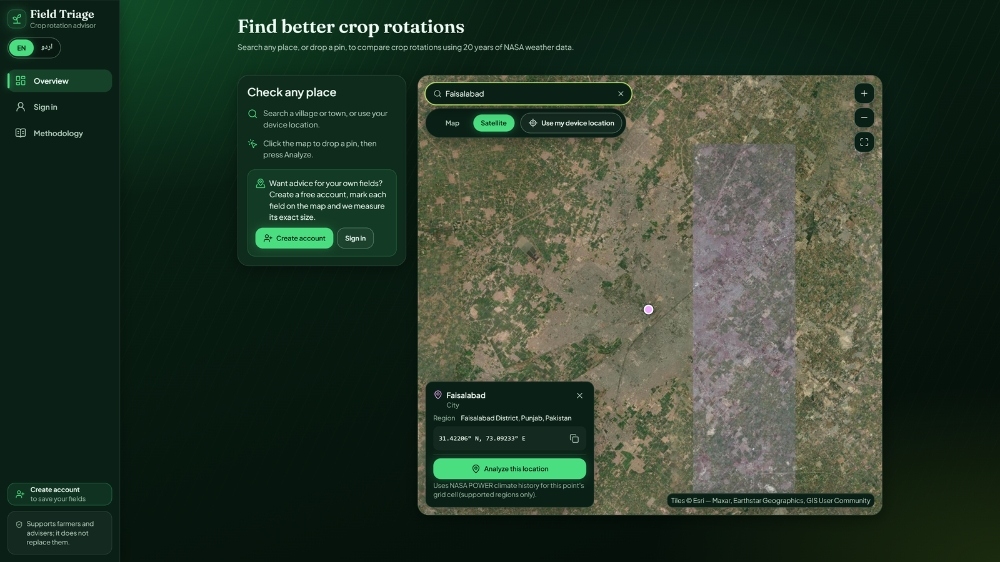
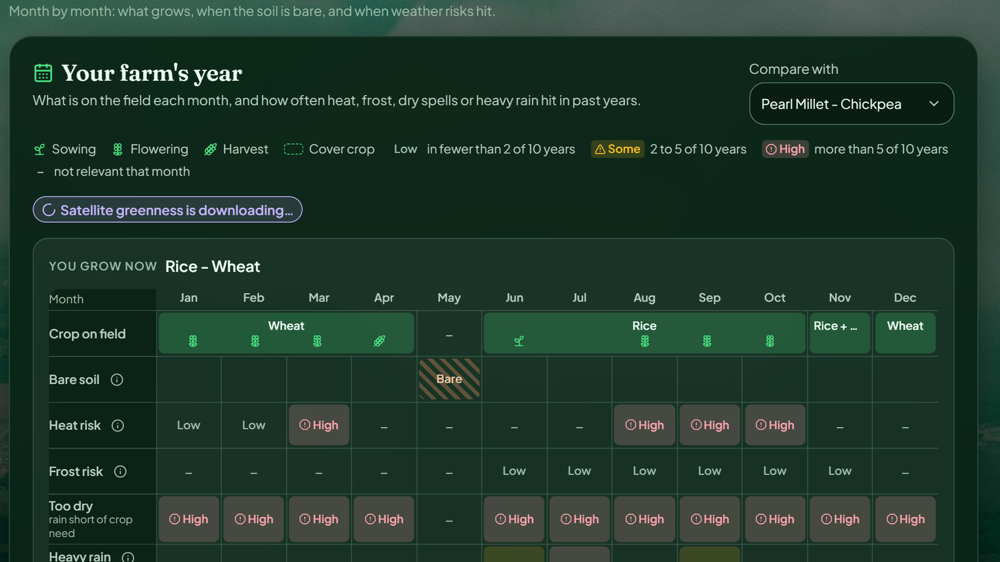
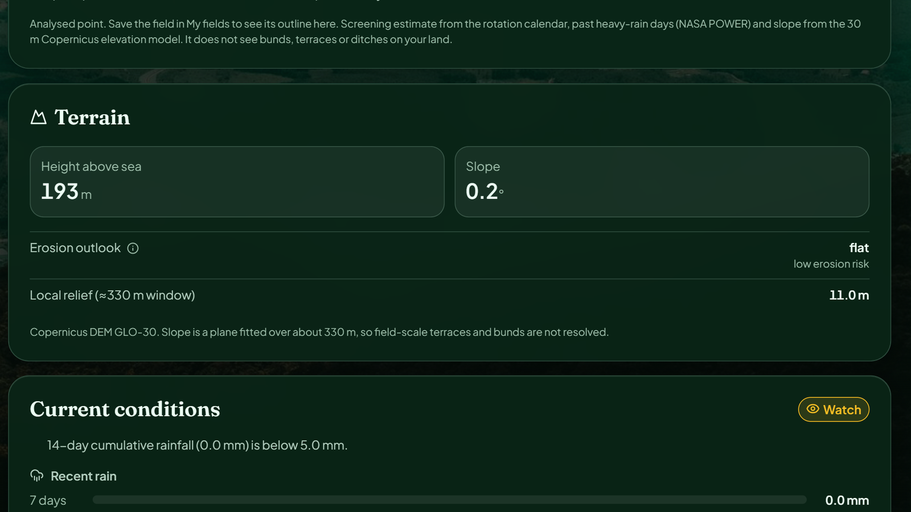
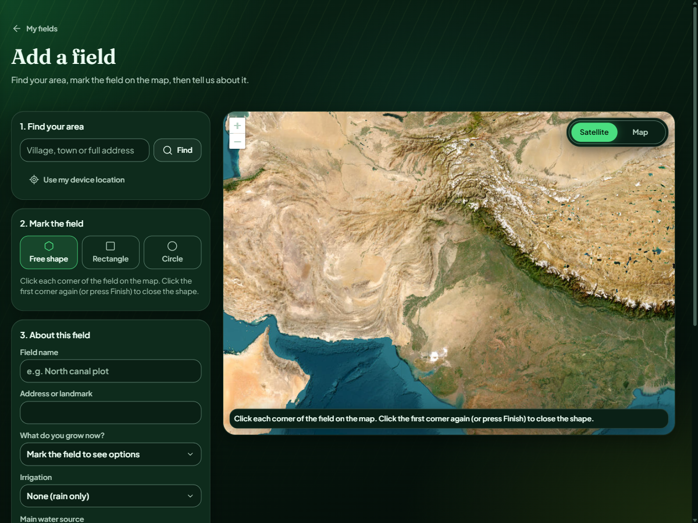
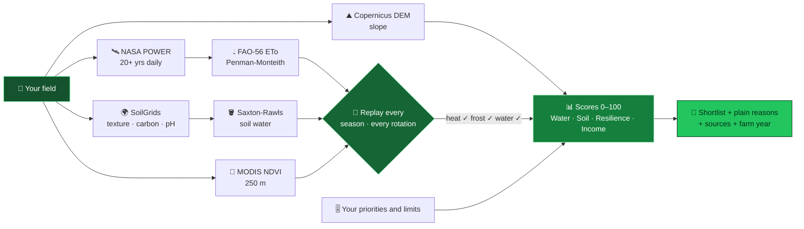

<div align="center">


<br/>


<br/><br/>

**[🎬 Demo](#-demo) · [🚀 Quick start](#-quick-start) · [🛰️ NASA data](#%EF%B8%8F-nasa-data-we-use) · [🧪 How scoring works](#-how-the-science-works) · [📖 Full documentation](DOCUMENTATION.md)**

</div>

---

> [!IMPORTANT]
> **Decision support, not a forecast.** Field Triage shows how each crop rotation *would have done* across 20+ years of real NASA weather at your spot. It supports farmers and advisers. It does not replace them, a soil test, or a local agronomist.

## 👥 Team Krypton Knights

| Member | Name | Role |
|---|---|---|
| M1 | **Ahmed Jabbar** (team lead) | NASA dataset collection |
| M2 | **Muhammad Naveed Qasim** | Backend: API, scoring engine, data services |
| M3 | **Muhammad Safiullah** | Local crop data collection |
| M4 | **Muhammad Tayyab Abdullah Malik** | Frontend: UI / UX and web app |

**Challenge:** Field Shift (NASA Space Apps Challenge 2026)

## 🎬 Demo

| | File |
|---|---|
| 🎥 Global demo video (28 s, voice-over) | [`submission/Field_Triage_Global_30s.mp4`](submission/Field_Triage_Global_30s.mp4) |
| 🎥 Local demo video with team intro (45 s) | [`submission/Field_Triage_Local_45s.mp4`](submission/Field_Triage_Local_45s.mp4) |
| 📊 Slides (7) | [`submission/Field_Triage_Slides.pdf`](submission/Field_Triage_Slides.pdf) · [`.pptx`](submission/Field_Triage_Slides.pptx) |

## 🌱 The problem

Farmers face hotter flowering seasons, erratic rain, falling water tables and tired soil. A rotation choice lasts for years, and a crop that helps the soil in one village can **run out of water, burn in the heat, or miss the market** in the next. Most farmers make this choice without any climate evidence for their own field.

**Who it is for:** smallholder and family farmers, agricultural extension workers and advisers, and farmer cooperatives. It starts with Pakistan's four provinces.

## ✨ What it does

<table>
<tr>
<td width="33%" align="center">

### 🗺️ Find your field
Search your village, use GPS or drop a pin. Signed-in farmers draw the field as a **free shape, rectangle or circle**, with live area (m² · ha · acres), perimeter and side lengths.

</td>
<td width="33%" align="center">

### 🛰️ Replay NASA history
The app downloads **20+ years of daily NASA POWER weather** for that spot, plus **MODIS NDVI** greenness, soil (SoilGrids) and slope (Copernicus DEM). It then replays **every past season** of every rotation in the province.

</td>
<td width="33%" align="center">

### 🌾 Compare & decide
**Your current rotation** next to the **best water-saving, soil-building, income and conventional** options, scored on 💧 Water · 🪱 Soil · 🛡️ Resilience · 💰 Income with **your** priorities, plain reasons and a source for every line.

</td>
</tr>
</table>

**Farmer inputs in real units:** water per season (mm, inches, acre-feet, m³, tubewell hours × flow, canal turns), minimum income (PKR or USD, per acre or per hectare), bad seasons accepted in 10 years, equipment you do *not* have, goals in order, and "what if" rain and warming.

**Results:** best fit with its score range, a month-by-month **farm year** (crops, bare soil, heat, frost, dry-spell and heavy-rain risk), a ranked comparison, score radar, water balance, climate charts, an erosion map of the field, the last 30 days, data sources, and a "satellite vs ground" explainer. Everything is available in **English and Urdu (right-to-left)**.

## 📸 Screenshots

<div align="center">

| 🏠 Find your field | 🏆 Best rotation for this spot |
|:---:|:---:|
|  |  |
| **📊 Compare rotations** | **💬 Why, risks and sources** |
|  |  |
| **📅 Your farm's year** | **⛰️ Site conditions and erosion map** |
|  |  |



<sub>✏️ <b>Add a field:</b> draw it on satellite imagery. The area is measured on the sphere and checked again by PostGIS.</sub>

</div>

## 🎯 Built for the challenge

| The challenge asks for… | Field Triage gives… |
|---|---|
| 🛰️ NASA Earth observations + local soil, crops, priorities | NASA POWER (8 parameters) + MODIS NDVI + SoilGrids + Copernicus DEM + a 75-crop catalog + the farmer's own limits |
| 🔁 Compare **≥ 3 rotations, including the current one** | Every rotation in the province (36 in Punjab) is scored; the shortlist shows **"Your current"** plus the best of each strategy |
| ❓ Why · 📑 evidence · ✅ benefits · ⚠️ risks · 🕳️ gaps | Insight cards and an evidence explorer for each rotation, every line linked to FAO / USDA / journal sources |
| 🌡️ Heat, ❄️ frost, 🌧️ rain extremes, 💧 water balance | Heat days at flowering (every degree 24–49 °C), frost days, heavy-rain days ≥ 25 mm, FAO-56 crop water demand |
| 🟫 Bare-soil periods, 🐛 pest-cycle breaks, 🫘 nitrogen | Farm-year strip, living-root months, NRCS-328 pest break, cited legume nitrogen (bags of urea saved) |
| 🎚️ Scenario sliders and uncertainty | Rain and warming "what if", 10th–90th percentile score range, confidence level |
| 👩‍🌾 Farmer-friendly, supports local expertise | Plain words, glossary tooltips, Urdu, cards hidden when there is no data, a "check locally" list on every result |

## 🛰️ NASA data we use

<details open>
<summary><b>NASA POWER Daily API</b>: live for every analysis (2005 → today)</summary>

<br/>

`GET https://power.larc.nasa.gov/api/temporal/daily/point` · `community=AG` · no key needed · cached per 0.5° cell

| Parameter | What it is | Unit | Used for |
|---|---|---|---|
| `PRECTOTCORR` | Bias-corrected precipitation (MERRA-2) | mm/day | Rain, effective rain, heavy-rain days, dry spells |
| `T2M` | Mean air temperature, 2 m | °C | Monthly climate, warming scenario |
| `T2M_MAX` | Max temperature, 2 m | °C | 🔥 Heat days at flowering |
| `T2M_MIN` | Min temperature, 2 m | °C | ❄️ Frost days ≤ 0 °C |
| `RH2M` | Relative humidity, 2 m | % | FAO-56 Penman-Monteith ETo |
| `WS2M` | Wind speed, 2 m | m/s | FAO-56 Penman-Monteith ETo |
| `ALLSKY_SFC_SW_DWN` | Solar radiation (CERES) | MJ/m²/day | FAO-56 Penman-Monteith ETo |
| `GWETROOT` | Root-zone soil wetness (MERRA-2) | 0–1 | Soil-moisture evidence and "right now" status |

</details>

<details>
<summary><b>MODIS NDVI</b> per field, and <b>SMAP L4</b> for the pilot field</summary>

<br/>

| Dataset | Access | Attributes | Used for |
|---|---|---|---|
| 🌿 MODIS Terra MOD13Q1 v061, 250 m, 16-day | ORNL DAAC web service → NASA AppEEARS (Earthdata login), background job, cached per pixel | `NDVI`, pixel reliability (only good/marginal kept) | Observed bare-soil months and greenness per field |
| 💧 SMAP L4 SPL4SMGP v008, 9 km | Google Earth Engine `NASA/SMAP/SPL4SMGP/008` | `sm_surface`, `sm_rootzone` (m³/m³) | Pilot field soil-moisture profile |

Scripts are in [`pipeline/`](pipeline/); the backend MODIS service is [`backend/app/services/modis_ndvi.py`](backend/app/services/modis_ndvi.py).

</details>

<details>
<summary><b>Partner and other open data</b></summary>

<br/>

| Source | Use |
|---|---|
| 🇪🇺 **Copernicus DEM GLO-30** (ESA / EU, public AWS tiles) | Elevation and slope, used in the erosion score |
| 🌍 **ISRIC SoilGrids v2.0** | Clay, sand, organic carbon, pH (0–30 cm), giving texture and water-holding capacity |
| 🌾 **FAOSTAT** (UN FAO) | National yield and producer price for the income score |
| 🗺️ OpenStreetMap (Nominatim, Photon) · Esri basemaps | Address search, province lookup, map and satellite tiles |

</details>

## 🧪 How the science works



| Score | How it is calculated |
|---|---|
| 💧 **Water** | 100 × (1 − mean seasonal shortfall ÷ 500 mm), where demand = Σ Kc × ETo and supply = USDA-SCS effective rain + soil water + irrigation |
| 🪱 **Soil** | 50 % soil health (living-root months + legume nitrogen, USDA-NRCS) · 30 % erosion cover (bare months × slope × heavy rain) · 20 % pest break (NRCS 328) |
| 🛡️ **Resilience** | Share of past seasons where heat, frost **and** water were all OK |
| 💰 **Income** | FAOSTAT yield × price × viable share. Scored only when **every** crop has current official data; otherwise left out and the other weights are rescaled. |

**Shortlist:** all rotations in the province are scored; the farmer sees their current rotation plus the best option that fits their limits for each strategy (water-saving, soil-building, income, conventional), and "Show all" for the rest. A rotation that breaks a limit says why ("doesn't fit your farm because…").

> [!NOTE]
> 🤖 **No AI inside the app.** Scoring is deterministic maths and the explanations are rule-based. The same input always gives the same answer. Missing data is **never** shown as zero.

## 🏗️ Architecture

```
field-triage/
├── 🐍 backend/        FastAPI · rotation engine · FAO-56 agromet · MODIS NDVI · farm year · explanations · 101 tests
├── ⚛️ frontend/       React 19 · Vite · Tailwind · Leaflet · Recharts · Supabase auth · English + Urdu
├── 🛰️ pipeline/       NASA POWER / SMAP / MODIS extraction & validation (Earth Engine)
├── 📦 data/           75 crops · 54 rotations · 4 provinces · parameters · FAOSTAT market · NASA data
├── 🗄️ supabase/       Postgres + PostGIS schema with Row-Level Security
├── 🎬 submission/     demo videos and slides
└── 📖 docs/           screenshots and earlier documentation
```

<details>
<summary><b>🔌 REST API</b> (<code>/api/v1</code>, docs at <code>localhost:8000/docs</code>)</summary>

<br/>

| Method | Path | Purpose |
|---|---|---|
| `POST` | `/locations/compare` | ⭐ Rank rotations for a point (with farmer limits) |
| `GET` | `/locations/ndvi` | MODIS NDVI download status for a point |
| `GET` | `/locations/region` | Province and rotations for a point |
| `GET` | `/locations/data` | SoilGrids + DEM for any point |
| `GET` | `/regions` · `/rotations` · `/crops` · `/meta/sources` | Catalog |
| `GET` | `/geocode?q=` | Address → coordinates |
| `GET` | `/health` | Status |

</details>

## 🚀 Quick start

```bash
# 1️⃣  Backend
cd backend
python -m venv .venv && .venv/Scripts/activate      # macOS/Linux: source .venv/bin/activate
pip install -r requirements.txt
python -m uvicorn app.main:app --port 8000

# 2️⃣  Frontend (new terminal)
cd frontend
npm install
npm run dev                                         # → http://localhost:5173
```

<details>
<summary>⚙️ Configuration and database</summary>

<br/>

- `frontend/.env.local`: `VITE_USE_MOCK=false`, `VITE_API_URL=http://localhost:8000`, `VITE_SUPABASE_URL`, `VITE_SUPABASE_ANON_KEY` (publishable key only; the data is protected by Row-Level Security).
- `backend/.env` (optional): `EARTHDATA_USERNAME` / `EARTHDATA_PASSWORD` for live MODIS NDVI through NASA AppEEARS.
- Database: run the files in [`supabase/migrations/`](supabase/migrations/) in the Supabase SQL editor (see [`supabase/README.md`](supabase/README.md)).
- Refresh market data: `python backend/scripts/build_market_data.py`.

</details>

```bash
# ✅ Checks
cd backend && python -m pytest -q        # 101 passed
python data/validate_data.py             # ALL CHECKS PASSED
cd frontend && npm run build             # type-check + production build
```

## 🗺️ Coverage today

| Province | Rotations | Examples |
|---|---|---|
| 🇵🇰 **Punjab** | 36 | Rice–Wheat · Cotton–Wheat · Pearl Millet–Chickpea 💧 · Sorghum–Berseem 🪱 |
| 🇵🇰 **Sindh** | 9 | |
| 🇵🇰 **Khyber Pakhtunkhwa** | 6 | |
| 🇵🇰 **Balochistan** | 3 | |

<details>
<summary>⚠️ Honest limitations</summary>

<br/>

- The NASA POWER climate cell is about 50 km wide, not a field sensor.
- SMAP is used for the pilot field only; MODIS NDVI per field needs a free NASA Earthdata login on the server.
- Province boundaries are approximate rectangles refined by reverse geocoding; some provinces borrow a neighbour's crop calendar (flagged as "check locally").
- Parameters are literature-based but not yet field-validated, so confidence is capped at MEDIUM.
- FAOSTAT prices are national averages, and some crops have no recent price. When that happens, income is shown as "not compared".

</details>

## 🛣️ Roadmap

- [x] Live NASA POWER analysis for any point in a supported province
- [x] FAO-56 water balance, SoilGrids soil, Copernicus slope
- [x] Accounts, field drawing, and per-field sales estimates
- [x] MODIS NDVI per field (AppEEARS), farm year, farmer limits
- [x] Urdu with right-to-left layout
- [ ] SMAP soil moisture for any point
- [ ] More regions and crop calendars
- [ ] Validation with local agronomists

## 🤝 Acknowledgements

- 🛰️ **NASA** POWER (LaRC), MERRA-2 (GMAO), CERES, MODIS (LP DAAC, ORNL DAAC, AppEEARS), SMAP (NSIDC)
- 🇪🇺 **ESA / Copernicus** DEM · 🌍 **ISRIC** SoilGrids · 🌾 **FAO** FAOSTAT & FAO-56 · 🇺🇸 **USDA-NRCS**
- 🗺️ OpenStreetMap contributors · Esri basemaps · Google Fonts

Full data sources, references and the technology list are in **[DOCUMENTATION.md](DOCUMENTATION.md)**.

<sub>🤖 <b>AI disclosure (NASA Space Apps 2026 rules):</b> parts of this code, the documentation and the demo edit were made with help from <b>Claude Code</b> (Anthropic's Claude), then reviewed and tested by the team. The demo voice-over is synthetic (Piper TTS) and the videos carry a visible label. The idea, the data choices and the science are the team's own. The app uses no AI at runtime.</sub>

<div align="center">


**Made with 💚 for farmers by Krypton Knights · NASA Space Apps Challenge 2026**

</div>
