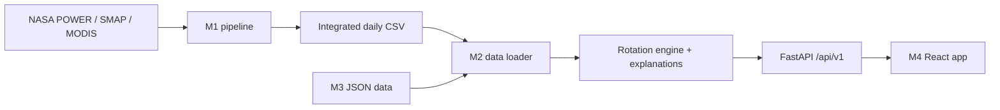

# Field Shift Advisor

A decision-support tool that compares crop-rotation options for a field, using NASA Earth-observation data and local agricultural information.

> **Decision support only.** Results are scores and explanations based on stated assumptions. They do not guarantee agronomic outcomes. Local agronomic review is still needed.

## 1. Project Overview

For a selected field, the app:

1. Loads climate, soil-moisture and vegetation history (NASA data).
2. Scores several crop rotations (current and alternatives) on water, soil, income and resilience.
3. Shows scores, benefits, risks, data gaps, evidence, data source and confidence.

NASA data supports the decision by showing how much rain, heat and soil moisture a field has had, and how green the vegetation was. The rotation engine compares these records with each crop's calendar and needs.

Scoring weights and thresholds in `data/parameters.json` are marked `"validated": false, "status": "illustrative"`. They are assumptions, not validated values.

## 2. System Architecture

| Module | Role | Where |
|---|---|---|
| M1 | NASA data extraction and integration | `pipeline/`, `data/raw/`, `data/processed/` |
| M2 | Backend API, data loading, rotation engine, scoring, explanations | `backend/` |
| M3 | Crop, rotation, field and source data | `data/*.json`, `data/validate_data.py` |
| M4 | React frontend | `frontend/` |



Each module was built by its own contributor. This repository combines them.

## 3. Technology Stack

- **Backend:** Python, FastAPI, Uvicorn, Pydantic v2, pandas, numpy, scipy, pyarrow, pymannkendall, httpx, python-dotenv, pytest.
- **Pipeline (M1):** Python scripts (see `pipeline/requirements.txt`) including Google Earth Engine for SMAP and MODIS, and the NASA POWER API.
- **Frontend:** React 19, TypeScript, Vite, Tailwind CSS, React Router, Leaflet / react-leaflet, Recharts.
- **Data storage:** JSON and CSV files (no database).

## 4. Backend Architecture

```
backend/app/
  main.py                    FastAPI app, CORS, error handlers, router registration
  config.py                  Settings from environment (.env)
  api/                       Routers: health, fields, rotations, crops, meta, now
  models/schemas.py          Pydantic contracts (FieldProfile, CompareRequest/Response, ...)
  services/data_loader.py    Loads JSON data and field profiles
  services/m1_profile.py     Builds an observed FieldProfile from the M1 CSV
  services/rotation_engine.py  Deterministic rotation scoring
  services/explain.py        Evidence, benefits, risks, data gaps, confidence text
  services/power_live.py     Optional live NASA POWER call for /now
  utils/validation.py        Typed errors and input checks
```

**Validation.** Pydantic models define every request and response. Scenario inputs are range-checked (for example `rain_multiplier` 0.6–1.4, `temp_delta_c` 0–4). Priority weights are validated by the engine.

**Rotation engine.** Pure calculation with no AI or network calls. For each historical year it checks each crop season against heat, frost and water limits, then combines four scores (0–100):

| Score | Meaning |
|---|---|
| water | How much of the crop water need rain, soil water and irrigation cover |
| soil | Soil health, erosion cover and pest break (weights in `parameters.json`) |
| income | Crop income and market access |
| resilience | Share of historical seasons that were viable |

`overall` is the weighted sum using the user's priorities. `overall_low` and `overall_high` are the 10th and 90th percentiles across historical years. They are not forced to include `overall`.

**Missing data.** Missing values stay `null`. They are never turned into zero. Demo data never counts toward real observation coverage.

**Confidence.** `HIGH`, `MEDIUM` or `LOW`, based on how much real evidence exists (power, smap, modis, soil, terrain) and how many years are available. Thresholds are in `parameters.json`.

**Explanations.** Each rotation includes `why`, `benefits`, `risks`, `data_gaps`, `needs_local_review` and `evidence` (variable, value, unit, source, interpretation). Responses also carry `data_mode`, `data_quality` and a disclaimer.

**Errors.** All errors return `{"detail": ...}`:

| Status | Cause |
|---|---|
| 404 | Unknown field ID |
| 422 | Invalid request |
| 503 | Profile unavailable (for example no observed data for that field) or dataset problem |
| 500 | Unexpected error (details are logged, not returned) |

## 5. NASA Data Pipeline

```
NASA sources -> M1 extraction -> data/raw/<field>/ -> data/processed/<field>/ -> M2 loader -> FieldProfile -> engine -> API
```

| Source | Use | Limits |
|---|---|---|
| NASA POWER | Daily rain, temperature, humidity, solar radiation | Gridded data, not field sensors |
| SMAP L4 | Surface and root-zone soil moisture | About 9–11 km cells, a regional estimate |
| MODIS NDVI/EVI | Vegetation greenness | About 250 m, 16-day composite, not an instant measurement |

`pipeline/` holds the extraction, integration and validation scripts. `integrate_nasa_data.py` writes `data/processed/F01/F01_nasa_integrated_daily.csv` (daily rows, 2015-03-31 to 2026-11-09).

**How the CSV becomes a profile** (`m1_profile.py`):
- Monthly values are only reported if at least 80% of the month's days exist.
- NDVI uses one value per 16-day composite, keeping quality flags 0 and 1 only.
- Annual statistics use complete calendar years only.
- Source descriptions and retrieval dates come from the `*_metadata.json` files in `data/raw/F01/`.

**Current data coverage**

| Field | Data |
|---|---|
| F01 | Real NASA observations (POWER, SMAP, MODIS) |
| F02–F08 | **Demo only.** No real data in the repository |

In `processed` mode, F02–F08 return a 503 explaining that no observed data exists. In `demo` mode they return synthetic profiles labelled `demo`.

**Not available yet:** soil (SoilGrids) and terrain (SRTM) values. They are reported as `unavailable`. Bare-soil days, evapotranspiration and water deficit cannot be derived from the M1 CSV and are left missing.

## 6. Database and Data Loading

**There is no database.** No SQL, migrations or seeding exist. All data is read from files:

| Data | File |
|---|---|
| Fields (location, soil type, irrigation, current rotation, boundary) | `data/fields.json` |
| Crops | `data/crops.json` |
| Rotations | `data/rotations.json` |
| Scoring parameters | `data/parameters.json` |
| NASA source descriptions | `data/nasa_metadata.json` |
| Demo profiles (synthetic) | `data/demo/profiles/F01..F08.json` |
| Real observations | `data/processed/F01/F01_nasa_integrated_daily.csv` |

`DataLoader` reads and caches the JSON files at first use. For a profile:
- `DATA_MODE=demo`: reads `data/demo/profiles/<id>.json`.
- `DATA_MODE=processed`: reads `data/processed/<id>/profile.json` if present, otherwise builds the profile from the integrated CSV (cached until the file changes).

The profile's public `data_mode` is `demo` or `observed`. Run `python data/validate_data.py` to check the JSON files.

## 7. Frontend Integration

- `frontend/src/api/client.ts` makes all requests. The base URL is `VITE_API_URL`.
- `GET /api/v1/fields` and `/fields/{id}/profile` provide field data. `POST /api/v1/rotations/compare` sends the field, priorities and scenario, and the pages show the returned scores.
- Backend error messages (the `detail` text) are included in thrown errors. If a field cannot be loaded, the field page shows "Could not load this field" with a link back.
- **Mock mode:** `VITE_USE_MOCK=true` reads static demo files from `frontend/public/mock/` and needs no backend. **Backend mode:** `VITE_USE_MOCK=false`.
- Field boundaries are hand-drawn demo polygons, not surveyed parcels. The UI says so.

## 8. API Reference

Base path: `/api/v1`. Interactive docs: `http://localhost:8000/docs`.

| Method | Path | Purpose |
|---|---|---|
| GET | `/health` | Status and active data mode |
| GET | `/fields` | List fields |
| GET | `/fields/{field_id}/profile` | Field profile (monthly history, climatology, soil, terrain, now, sources, quality) |
| GET | `/fields/{field_id}/now` | Current status (FAVORABLE / WATCH / STRESSED) with reasons. Can use live NASA POWER |
| POST | `/rotations/compare` | Compare rotations for a field |
| GET | `/rotations` | List rotations |
| GET | `/crops` | List crops |
| GET | `/meta/sources` | NASA source metadata |

`POST /rotations/compare` body:

```json
{
  "field_id": "F01",
  "priorities": {"w_water": 0.25, "w_soil": 0.25, "w_income": 0.25, "w_resilience": 0.25},
  "scenario": {"rain_multiplier": 1.0, "temp_delta_c": 0.0},
  "rotation_ids": null
}
```

Only `field_id` is required. The response contains ranked `rotations`, `data_mode`, `data_quality` and a `disclaimer`.

## 9. Installation and Running

Requires Python 3 (tested with 3.14) and Node.js.

```bash
git clone https://github.com/DEVCOPS-8997/field-triage.git
cd field-triage
git checkout feat/m2-backend-integration
```

**Backend**

```bash
pip install -r backend/requirements.txt
cp .env.example .env          # edit DATA_MODE if needed
cd backend
python -m uvicorn app.main:app --port 8000
```

**Data mode** (in `.env`): `DATA_MODE=demo` for synthetic data, or `DATA_MODE=processed` for real data (F01 only).

**Frontend** (new terminal)

```bash
cd frontend
npm install
cp .env.example .env.local     # set VITE_USE_MOCK=false to use the backend
npm run dev                    # http://localhost:5173
```

The `.env.example` also lists optional NASA/Earth Engine credentials. These are only for running the M1 pipeline, not the app.

## 10. Testing and Current Limitations

```bash
cd backend && python -m pytest -q        # backend tests
python data/validate_data.py             # dataset validation (from repo root)
cd frontend && npm run build             # frontend production build
```

**Last verified results:** 32 backend tests passed, dataset validation passed (8 fields, 10 crops, 10 rotations, 15 sources), frontend build succeeded. The API and frontend were also checked together against F01 in `processed` mode.

**Known limitations**
- Only F01 has real NASA data. F02–F08 are demo only.
- No soil or terrain observations yet.
- Scoring weights and thresholds are unvalidated assumptions.
- F01 rainfall statistics come directly from NASA POWER and look high (about 1,550 mm per year). They have not been cross-checked.
- Field boundaries are demo polygons.
- The frontend has no automated tests.

## Project Structure

```
backend/      FastAPI app and tests
frontend/     React app
pipeline/     M1 NASA extraction and validation scripts
data/         JSON data, demo profiles, raw and processed NASA data
.env.example  Environment template
```
