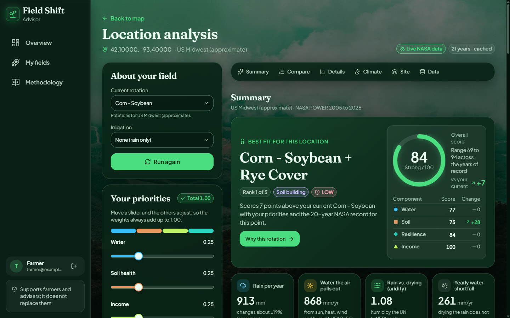
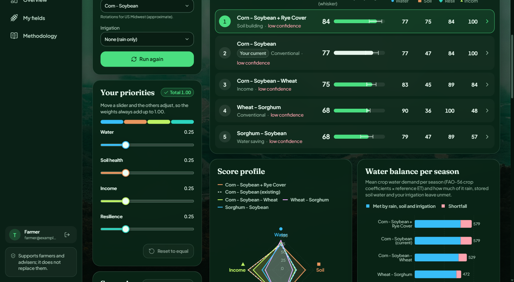
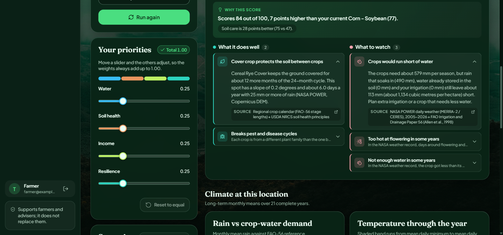
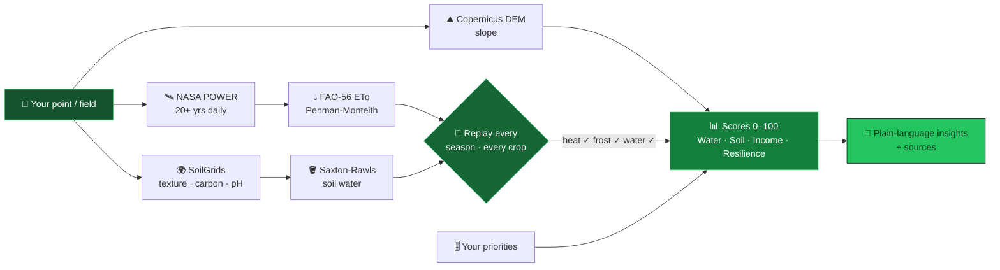

<div align="center">


<a href="#-what-it-does">
  
</a>

<br/>


<br/><br/>

**[🚀 Quick start](#-quick-start) · [🛰️ NASA data](#%EF%B8%8F-nasa-data-we-use) · [🧪 How scoring works](#-how-the-science-works) · [📖 Full documentation](docs/PROJECT_DOCUMENTATION.md)**

</div>

---

> [!IMPORTANT]
> **Decision support, not a forecast.** Field Shift Advisor shows how each crop rotation *would have done* across 20+ years of real NASA weather at your spot. It supports farmers and advisers; it does not replace them, a soil test, or a local agronomist.

## 🌱 The problem

Farmers face hotter flowering seasons, erratic rain, falling water tables and tired soil. A rotation choice lasts for years, and a crop that helps soil in one village can **run out of water, get burned by heat, or miss the market** in the next. Most farmers make this choice without any climate evidence for their own field.

## ✨ What it does

<table>
<tr>
<td width="33%" align="center">

### 🗺️ Mark your field
Search your village or use GPS, then draw the field as a **free shape, rectangle or circle**. The area (m² · ha · acres), perimeter and each side's length update live.

</td>
<td width="33%" align="center">

### 🛰️ Replay NASA history
The app downloads **20+ years of daily NASA POWER weather** for that spot, plus soil (SoilGrids) and slope (Copernicus DEM), and replays **every past season** of every crop.

</td>
<td width="33%" align="center">

### 🌾 Compare & decide
It ranks **5 rotations, including yours**, on 💧 Water · 🪱 Soil · 💰 Income · 🛡️ Resilience, weighted by **your** priorities, with plain-language reasons and a source for each.

</td>
</tr>
</table>

## 📸 Screenshots

<div align="center">

| 🏠 Start anywhere | 🏆 Best rotation for this spot |
|:---:|:---:|
|  |  |
| **📊 Compare all rotations** | **💬 Benefits & risks, with sources** |
|  |  |


<sub>✏️ <b>Add a field:</b> draw it on satellite imagery, and the area is measured on the sphere and checked again by PostGIS.</sub>

</div>

## 🎯 Built for the challenge

| Challenge asks for… | Field Shift Advisor gives… |
|---|---|
| 🛰️ NASA Earth observations + local soil, crops, priorities | NASA POWER (8 parameters) + SoilGrids + Copernicus DEM + crop catalog + your farm form |
| 🔁 Compare **≥ 3 rotations including the current one** | **5 per region**: conventional, water-saving, soil-building, income, with **"Your current"** labelled |
| ❓ Why · 📑 evidence · ✅ benefits · ⚠️ risks · 🕳️ gaps | A tab for each rotation, every line linked to FAO / USDA / journal sources |
| 🌡️ Heat, ❄️ frost, 🌧️ rain extremes, 💧 water balance | Heat days at flowering, frost days, heavy-rain days ≥25 mm, FAO-56 crop water demand |
| 🟫 Bare-soil periods, 🐛 pest-cycle breaks, 🫘 nitrogen | Living-root months, NRCS-328 pest break, sourced legume N (bags of urea saved) |
| 🎚️ Scenario sliders and uncertainty | Rain 60–140 %, warming +0…+4 °C, 10th–90th percentile score range, confidence level |
| 👩‍🌾 Farmer-friendly, supports local expertise | Plain words, cards hidden when there is no data, a "check locally" list on every result |

## 🛰️ NASA data we use

<details open>
<summary><b>NASA POWER Daily API</b>: live for every analysis (2005 → today)</summary>

<br/>

`GET https://power.larc.nasa.gov/api/temporal/daily/point` · `community=AG` · no key needed · cached per 0.5° cell

| Parameter | What it is | Unit | Used for |
|---|---|---|---|
| `PRECTOTCORR` | Bias-corrected precipitation (MERRA-2) | mm/day | Rain, effective rain, heavy-rain days, dry spells |
| `T2M` | Mean air temperature, 2 m | °C | Monthly climate, warming scenario |
| `T2M_MAX` | Max temperature, 2 m | °C | 🔥 Heat days ≥ 30/34/38/42 °C at flowering |
| `T2M_MIN` | Min temperature, 2 m | °C | ❄️ Frost days ≤ 0 °C |
| `RH2M` | Relative humidity, 2 m | % | FAO-56 Penman-Monteith ETo |
| `WS2M` | Wind speed, 2 m | m/s | FAO-56 Penman-Monteith ETo |
| `ALLSKY_SFC_SW_DWN` | Solar radiation (CERES) | MJ/m²/day | FAO-56 Penman-Monteith ETo |
| `GWETROOT` | Root-zone soil wetness (MERRA-2) | 0–1 | Soil-moisture evidence and "right now" status |

</details>

<details>
<summary><b>SMAP L4 & MODIS</b>: pilot-field pipeline (Google Earth Engine)</summary>

<br/>

| Dataset | ID | Attributes |
|---|---|---|
| 💧 SMAP L4 soil moisture, 9 km, 3-hourly → daily | `NASA/SMAP/SPL4SMGP/008` | `sm_surface`, `sm_rootzone` (m³/m³) |
| 🌿 MODIS Terra vegetation, 250 m, 16-day | `MOD13Q1 v061` | `NDVI`, `EVI`, `SummaryQA` |

Scripts are in [`pipeline/`](pipeline/); the integrated daily file is in [`data/processed/F01/`](data/processed/F01/).

</details>

<details>
<summary><b>Partner and other open data</b></summary>

<br/>

| Source | Use |
|---|---|
| 🇪🇺 **Copernicus DEM GLO-30** (ESA / EU, public AWS tiles) | Elevation and slope (plane fit over ~330 m), used in the erosion score |
| 🌍 **ISRIC SoilGrids v2.0** | Clay, sand, organic carbon, pH (0–30 cm), giving texture and water-holding capacity |
| 🌾 **FAOSTAT** (UN FAO) | National yield and producer price for the income score (latest 3 years) |
| 🗺️ OpenStreetMap (Nominatim, Photon) · Esri basemaps | Address search · map and satellite tiles |

</details>

## 🧪 How the science works



| Score | How it is calculated |
|---|---|
| 💧 **Water** | 100 × (1 − mean seasonal shortfall ÷ 500 mm), where demand = Σ Kc × ETo and supply = USDA-SCS effective rain + soil water + irrigation |
| 🪱 **Soil** | 50 % soil health (living-root months + legume nitrogen, USDA-NRCS) · 30 % erosion cover (bare months × slope × heavy rain) · 20 % pest break (NRCS 328) |
| 🛡️ **Resilience** | Share of past seasons where heat, frost **and** water were all OK |
| 💰 **Income** | FAOSTAT yield × price × viable share. Only scored when **every** crop has current official data; otherwise left out and the other weights are rescaled. |

> [!NOTE]
> 🤖 **No AI inside the app.** Scoring is deterministic maths, and the explanations are rule-based. The same input always gives the same answer. Missing data is **never** shown as zero.

## 🏗️ Architecture

```
field-shift/
├── 🐍 backend/        FastAPI · rotation engine · FAO-56 agromet · explanations · 78 tests
├── ⚛️ frontend/       React 19 · Vite · Tailwind · Leaflet · Recharts · Supabase auth
├── 🛰️ pipeline/       NASA POWER / SMAP / MODIS extraction & validation (Earth Engine)
├── 📦 data/           crops · rotations · regions · parameters · FAOSTAT market · NASA data
├── 🗄️ supabase/       Postgres + PostGIS schema with Row-Level Security
└── 📖 docs/           full project documentation + screenshots
```

<details>
<summary><b>🔌 REST API</b> (<code>/api/v1</code>, docs at <code>localhost:8000/docs</code>)</summary>

<br/>

| Method | Path | Purpose |
|---|---|---|
| `POST` | `/locations/compare` | ⭐ Rank rotations for a point |
| `GET` | `/locations/region` | Region and rotations for a point |
| `GET` | `/locations/data` | SoilGrids + DEM for any point |
| `GET` | `/regions` · `/rotations` · `/crops` · `/meta/sources` | Catalog |
| `GET` | `/geocode?q=` | Address → coordinates |
| `GET` | `/health` | Status |

</details>

## 🚀 Quick start

```bash
# 1️⃣  Backend
cd backend
python -m venv .venv && .venv/Scripts/activate      # macOS/Linux: source .venv/bin/activate
pip install -r requirements.txt
python -m uvicorn app.main:app --port 8000

# 2️⃣  Frontend (new terminal)
cd frontend
npm install
npm run dev                                         # → http://localhost:5173
```

<details>
<summary>⚙️ Configuration and database</summary>

<br/>

- `frontend/.env.local`: `VITE_USE_MOCK=false`, `VITE_API_URL=http://localhost:8000`, `VITE_SUPABASE_URL`, `VITE_SUPABASE_ANON_KEY` (publishable key only; the data is protected by Row-Level Security).
- Database: run [`supabase/migrations/0001_user_fields.sql`](supabase/migrations/0001_user_fields.sql) in the Supabase SQL editor (see [`supabase/README.md`](supabase/README.md)).
- Refresh market data: `python backend/scripts/build_market_data.py`.

</details>

```bash
# ✅ Checks
cd backend && python -m pytest -q        # 78 passed
python data/validate_data.py             # ALL CHECKS PASSED
cd frontend && npm run build             # type-check + production build
```

## 🗺️ Coverage today

| Region | Rotations |
|---|---|
| 🇵🇰 **Punjab, Pakistan** | Cotton–Wheat · Rice–Wheat · Sorghum–Chickpea 💧 · Sorghum–Berseem 🪱 · Spring Maize–Wheat 💰 |
| 🇺🇸 **US Midwest** | Corn–Soy · Wheat–Sorghum · Sorghum–Soy 💧 · Corn–Soy + Rye cover 🪱 · Corn–Soy–Wheat 💰 |

<details>
<summary>⚠️ Honest limitations</summary>

<br/>

- The NASA POWER climate cell is about 50 km wide, not a field sensor.
- SMAP and MODIS are used for the pilot field only; live points use POWER root-zone wetness.
- There are two regions, defined as approximate rectangles. The parameters are literature-based but not yet field-validated, so confidence is capped at MEDIUM.
- FAOSTAT prices are national averages, and some Pakistani crops have no recent price. When that happens, income is shown as "not compared".

</details>

## 🛣️ Roadmap

- [x] Live NASA POWER analysis for any point in a supported region
- [x] FAO-56 water balance, SoilGrids soil, Copernicus slope
- [x] Accounts, field drawing, and per-field sales estimates
- [ ] SMAP & MODIS for any point
- [ ] More regions and crop calendars
- [ ] Urdu and other local languages
- [ ] Validation with local agronomists

## 🤝 Acknowledgements

- 🛰️ **NASA** POWER (LaRC), MERRA-2 (GMAO), CERES, SMAP (NSIDC), MODIS (LP DAAC)
- 🇪🇺 **ESA / Copernicus** DEM · 🌍 **ISRIC** SoilGrids · 🌾 **FAO** FAOSTAT & FAO-56 · 🇺🇸 **USDA-NRCS**
- 🗺️ OpenStreetMap contributors · Esri basemaps

<sub>🤖 <b>AI disclosure (NASA Space Apps 2026 rules):</b> parts of this code and documentation were drafted with <b>Claude Code</b> (Anthropic's Claude) and reviewed and tested by the team. The idea, the data choices and the science are the team's own. The app uses no AI at runtime. Details are in <a href="docs/PROJECT_DOCUMENTATION.md#16-use-of-super-intelligence-ai-disclosure">§16 of the documentation</a>.</sub>

<div align="center">


**Made with 💚 for farmers · NASA Space Apps Challenge 2026**

</div>
